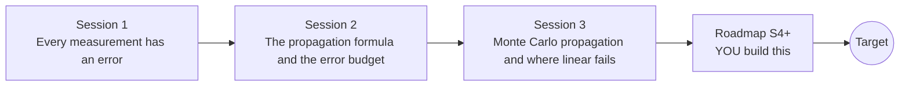

# openuncertainty

[](https://github.com/KrunalPanchal1995/openuncertainty/actions/workflows/ci.yml)   [](https://colab.research.google.com/github/KrunalPanchal1995/openuncertainty/blob/main/sessions/session-01/lesson.ipynb) [](https://krunalpanchal1995.github.io/openuncertainty/)

**Put honest error bars on a final answer, in three sessions.**

openuncertainty teaches how measurement errors flow through a formula into an answer, from a ruler reading to Monte Carlo, using only Python and a browser.

- **Start from a ruler.** Session 1 needs only multiplication and percentages; every symbol is explained.
- **See it move.** Every session ships a slider app that runs in the browser, with labelled graphs.
- **Know you got it right.** Each session ends with a checkpoint that prints PASS or FAIL against hand calculations and simulations.
- **Build the missing half.** The repo stops at Session 3 on purpose; the roadmap shows the path to the Target.

[Target](#the-target) · [Who is this for](#who-is-this-for) · [Quick start](#quick-start) · [Sessions](#sessions) · [Roadmap](#roadmap) · [Contribute](#contribute) · [Explainer PDF](docs/explainer.pdf)

> **This repo is incomplete on purpose.** Sessions 1 to 3 are here and fully working. The finished Target below is a preview of what the community can build next. We show you the path, not the code. Sessions 4 and up are yours.

## The Target

A cloud of possible input values flows through a formula into an output histogram. For the pendulum, the linear-propagation Gaussian (green) sits right on top of the histogram. Then the error of a denominator grows, and the Gaussian fails: for a 30 percent error the linear 95 percent interval is 0.8 to 3.2 while the Monte Carlo interval is 1.2 to 4.9. Finally one input is improved and the error budget bars and the histogram change together. Your goal over the coming sessions: build that animation yourself and add the tools that explain it.


*Target: input cloud, output histogram, linear Gaussian and the error budget*


*Target still: the linear Gaussian (green) fails for a ratio with a 27 percent denominator error*


*From the author's Dokimazo project: forward uncertainty propagation gives a skewed output histogram*

Try it live:

- [Math Visual Studio: uncertainty quantification (Atlas S27)](https://krunalpanchal1995.github.io/studio/#atlas?ch=S27&ex=1)

How the Target was made is shown only as a path in [promo/roadmap.md](promo/roadmap.md).

## Who is this for
**higher secondary to advanced undergraduate (levels 4-6).** Topic area: Statistics, Research and Experimental Methods.

Prerequisites:

- Multiplication, percentages and the idea of an average (school mathematics).
- Python 3.10 or newer; if `python --version` works, you are ready. PRIMER.md explains the rest.
- Session 2 uses derivatives (slopes) of simple formulas; the apps and Session 1 do not need them.
- No prior GitHub or statistics course is needed.

New to Python? Read [PRIMER.md](PRIMER.md) first (10 minutes).

## Quick start

No installation knowledge needed. You need [Git](https://git-scm.com/downloads) and [Python 3.10+](https://www.python.org/downloads/) (Windows: tick "Add Python to PATH"). On Mac and Linux type `python3` wherever this page says `python`.

```bash
git clone https://github.com/KrunalPanchal1995/openuncertainty.git
cd openuncertainty
python start.py 1
```

`start.py` creates a private environment, installs what is needed and runs Session 1 with its checkpoint. Next: `python start.py 2`, `python start.py 3`, or `python start.py test` to check everything. Only a checkpoint: `python start.py check 1`.

Four lines turn the idea of Session 2 into a result (they work as they are): Save it as `try.py` and run it with `python start.py run try.py` (this uses the private environment, where NumPy is installed):

```python
import numpy as np
rng = np.random.default_rng(0)
L, T = 1.000 + 0.005 * rng.standard_normal(100000), 2.007 + 0.010 * rng.standard_normal(100000)
print(round((4 * np.pi**2 * L / T**2).std(), 2))    # -> 0.11  the spread of g in m/s^2
```

Every session also opens in your browser with sliders (no install): [live apps](https://krunalpanchal1995.github.io/openuncertainty/). Or use the Colab badge above for the notebook.

## Sessions

| # | Session | Model level | Time | Live app |
|---|---|---|---|---|
| 1 | [Every measurement has an error](sessions/session-01/README.md) | Level 1: conceptual interactive model | 60 min | [open](https://krunalpanchal1995.github.io/openuncertainty/session-01/) |
| 2 | [The propagation formula and the error budget](sessions/session-02/README.md) | Level 2: mathematical engineering model | 75 min | [open](https://krunalpanchal1995.github.io/openuncertainty/session-02/) |
| 3 | [Monte Carlo propagation and where linear fails](sessions/session-03/README.md) | Level 3: simulation and validation | 90 min | [open](https://krunalpanchal1995.github.io/openuncertainty/session-03/) |

Each session follows the same six steps: A real-world problem, B concept and theory, C visual explanation, D interactive simulation, E worked example and experiment, F assessment and design challenge. Each ends with `checkpoint.py`, which prints `PASS` or `FAIL` against reference numbers. Session 3 also contains the real-world mini-project: **Error budget for the density of a metal cylinder**.

## Architecture



| Folder or file | What is inside |
|---|---|
| `sessions/` | three sessions: README (A-F), `lesson.py`, notebook, live app, exercises, activity sheet, checkpoint |
| `promo/` | the Target: media, live links, and the roadmap (path only) |
| `docs/` | `explainer.tex` and the built `explainer.pdf` |
| `tests/` | runs every lesson and checkpoint headless |
| `start.py` | one command to set up and run anything |
| `QUALITY.md`, `RUBRIC.md` | the quality checklist and the scoring rubric |
| `.github/` | CI, PDF build, Pages deploy, issue and PR templates |

## Roadmap

| Milestone | What you will build | Difficulty |
|---|---|---|
| Session 4: Correlated inputs for any number of variables | A sampler that draws three inputs with a given correlation matrix and propagates them. | intermediate |
| Session 5: Which input matters? Sobol indices | A sampling estimator of first-order indices for the Ishigami test function. | advanced |
| Session 6: Beyond first order: the mean shifts | A second-order propagation function for the ratio x / y. | intermediate |
| Session 7: A cheap stand-in for a slow model | A quadratic surrogate of the pendulum g built from 9 model runs. | advanced |
| Session 8: Animate the propagation | A looping GIF of an input cloud, an output histogram and an error budget, like the Target. | advanced |

Full detail with a checkpoint per milestone: [promo/roadmap.md](promo/roadmap.md).

## Contribute
New to GitHub? Read [CONTRIBUTING.md](CONTRIBUTING.md); it starts from zero. Pick an issue labelled `good first issue`. Translations into Hindi, Telugu, Tamil and Malayalam are welcome.

<details>
<summary>Development</summary>

```bash
python start.py test        # runs every lesson and checkpoint
```
Lessons use `# %%` cell markers so they open as notebooks in VS Code. See [QUALITY.md](QUALITY.md) for the standard every session meets.
</details>

## License
MIT. See [LICENSE](LICENSE). Media in `promo/media` is (c) Krunal Panchal, CC BY 4.0.

## Acknowledgments
Part of the [PAN IIT OSS](https://hellofoss.tech-iitb.org/projects) open-source teaching collection, modelled on the structure of [openspline](https://github.com/openspline/openspline). Built on ideas from the Math Visual Studio at https://krunalpanchal1995.github.io/studio/.
