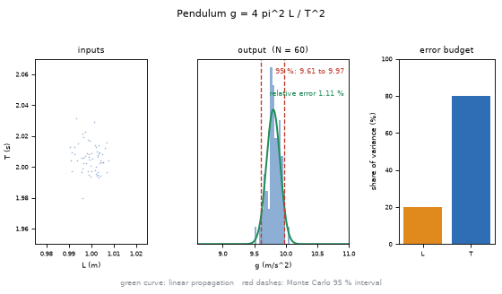
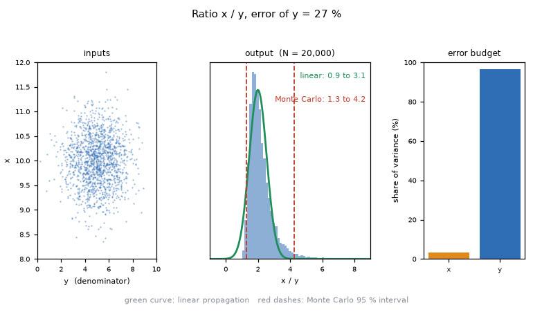
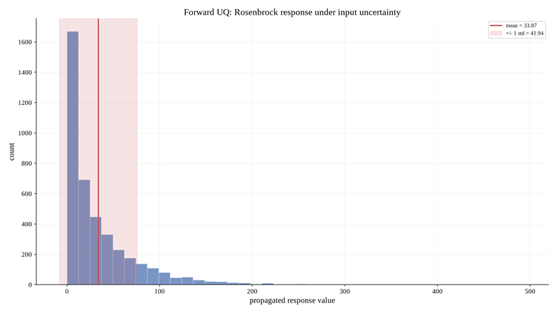

# What you are building toward

A cloud of possible input values flows through a formula into an output histogram. For the pendulum, the linear-propagation Gaussian (green) sits right on top of the histogram. Then the error of a denominator grows, and the Gaussian fails: for a 30 percent error the linear 95 percent interval is 0.8 to 3.2 while the Monte Carlo interval is 1.2 to 4.9. Finally one input is improved and the error budget bars and the histogram change together. Your goal over the coming sessions: build that animation yourself and add the tools that explain it.

*Target: input cloud, output histogram, linear Gaussian and the error budget*

*Target still: the linear Gaussian (green) fails for a ratio with a 27 percent denominator error*

*From the author's Dokimazo project: forward uncertainty propagation gives a skewed output histogram*

These results come from a private reference build. The code is not published; the roadmap shows the path so you can build your own.

Live links:

- [Math Visual Studio: uncertainty quantification (Atlas S27)](https://krunalpanchal1995.github.io/studio/#atlas?ch=S27&ex=1)
