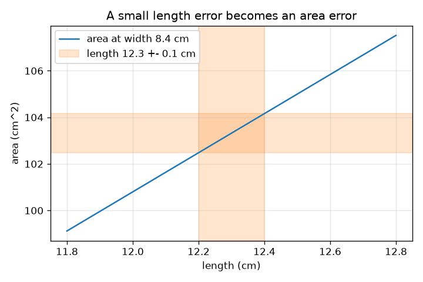
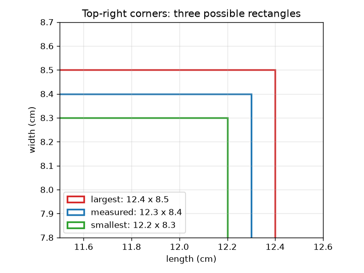

# Session 1: Every measurement has an error

*Level 1 (conceptual interactive model) · about 60 minutes · openuncertainty*

> This is a simplified educational model. It is not a validated design tool and must not be used for real structures, electrical installations, vehicles, industrial processes or medical decisions.

**Prerequisites**

- Multiplication and percentages.
- You have read PRIMER.md and run `python start.py 1` once.

**Learning objectives.** After this session you can:

- Write a measurement as value +- error and read it as an interval.
- Compute the smallest and largest possible area of a rectangle from two uncertain lengths.
- Convert an error into a relative error (a percentage).
- Explain why the error of a result is usually smaller than the worst case.

## A. Real-world problem
You measure the top of a table with a school ruler and read 12.3 cm for one side and 8.4 cm for the other. A ruler cannot be read exactly: the honest statement is 12.3 +- 0.1 cm. Now you want the area. If both lengths are a little uncertain, how uncertain is the area? Does the error carry through, shrink, or grow?

## B. Concept and theory
A measurement is written value +- error. It means the true value is believed to lie between value minus error and value plus error. The relative error is the error divided by the value (multiply by 100 for percent). For an area A = L * W of two positive lengths, the smallest area uses both smallest lengths and the largest uses both largest lengths. The half of the difference is the worst-case area error, L dW + W dL. Dividing by the area shows that the relative errors of the two sides add: dA / A = dL / L + dW / W. This worst case assumes both errors push the same way at once, which is unlikely, so the typical error is smaller; Session 2 shows by how much.

| Symbol | Meaning | Unit |
|---|---|---|
| L, W | measured length and width | cm |
| dL, dW | errors (half the reading uncertainty) | cm |
| A | area L * W | cm^2 |
| dA | worst-case error of the area | cm^2 |
| dL / L | relative error | no unit (or percent) |

**Assumptions**

- The errors are small compared with the values.
- Both lengths are positive.
- The error given is the largest the reading could plausibly be off (a worst case).

$$ x = x_0 \pm \delta x \;\Longleftrightarrow\; x_0-\delta x \le x_{\text{true}} \le x_0+\delta x $$

$$ A_{\min}=(L-\delta L)(W-\delta W),\qquad A_{\max}=(L+\delta L)(W+\delta W) $$

$$ \delta A=\frac{A_{\max}-A_{\min}}{2}=L\,\delta W+W\,\delta L $$

$$ \frac{\delta A}{A}=\frac{\delta L}{L}+\frac{\delta W}{W}\quad\text{(small errors)} $$

## C. Visual explanation
The left figure draws the measured rectangle with the smallest and largest possible rectangles; the gaps between the outlines are the errors. The right figure plots the area against the length at a width of 8.4 cm. The straight band around the line is the range of area when the length is known only to 0.1 cm; its height is the width times the length error, so a longer or wider rectangle has a bigger area error.

*A length known to 0.1 cm gives an area band 1.68 cm^2 tall at a width of 8.4 cm.*

*Three possible rectangles: the measured one and the smallest and largest.*

## D. Interactive simulation
Run the lesson (`python start.py 1`), then open the live app: [Session 1: error of an area](https://krunalpanchal1995.github.io/openuncertainty/session-01/) (or `app.html` in this folder). Change the lengths and errors and watch the three rectangles and the readout, then switch to the area view and see the band widen when you raise the errors.

**Challenge.** Keep the worst-case area error at or below 1 cm^2 for the 12.3 by 8.4 cm table by using a finer ruler (smaller errors).

## E. Worked example and experiment
**Problem.** A table is 12.3 +- 0.1 cm by 8.4 +- 0.1 cm. Find the area, its smallest and largest values, and the relative errors.

1. Area = 12.3 * 8.4 = 103.32 cm^2.
2. Smallest = 12.2 * 8.3 = 101.26 cm^2. Largest = 12.4 * 8.5 = 105.40 cm^2.
3. Half the difference = (105.40 - 101.26) / 2 = 2.07 cm^2.
4. Relative errors: 0.1 / 12.3 = 0.81 percent and 0.1 / 8.4 = 1.19 percent; their sum is 2.0 percent.
5. Check: 2.0 percent of 103.32 is 2.07 cm^2, the same as the half-range.

**Answer.** Area = 103.32 cm^2, between 101.26 and 105.40 cm^2: about 103.3 +- 2.1 cm^2 (2.0 percent).

**Experiment.** Measure a book cover with a school ruler twice, once with the ruler laid carefully and once quickly, and compute the area range each time. The model says the area error is 2.07 cm^2 for a reading error of 0.1 cm. Differences come from parallax (looking at the ruler from an angle) and uneven edges: the model has only the reading error, the book has more.

## F. Assessment and design challenge
**Question type A: Conceptual.** The worst-case area error for the table is 2.07 cm^2, but the typical error is smaller (about 1.49 cm^2, shown in Session 2). Why is the typical error smaller than the worst case?

Hint

For the worst case, both lengths must be wrong in the 'bigger' direction at the same time. How likely is that?

Step-by-step solution

The worst case needs the length error and the width error to be at their extreme values and push the same way. Usually one reading is a bit high and the other a bit low or small, so their effects partly cancel. Combining independent errors by adding their squares (quadrature) gives sqrt((8.4*0.1)^2 + (12.3*0.1)^2) = 1.49 cm^2, which is less than 2.07.

**Question type B: Numerical.** A rectangle measures 20.0 +- 0.1 cm by 5.0 +- 0.1 cm. Find the area, its smallest and largest values, the worst-case error and the relative error.

Hint

Use the smallest and largest lengths, then half the difference.

Step-by-step solution

Area = 100.0 cm^2. Smallest = 19.9 * 4.9 = 97.51 cm^2, largest = 20.1 * 5.1 = 102.51 cm^2. Half the difference = 2.50 cm^2, so the area is 100.0 +- 2.5 cm^2. Relative errors: 0.5 percent + 2.0 percent = 2.5 percent. Sanity check: 2.5 percent of 100 is 2.5. The short side dominates because its relative error is four times bigger.

**Question type C: Graph and simulation interpretation.** On the area graph (width 8.4 cm), how tall is the band at a length of 12.3 cm when the length error is 0.1 cm and the width is exact? Why is it a straight band?

Hint

Read the area at 12.2 cm and at 12.4 cm, or multiply the slope by the length range.

Step-by-step solution

The area at 12.4 cm is 104.16 and at 12.2 cm is 102.48 (width 8.4 cm), so the band is 1.68 cm^2 tall (+- 0.84). The area is a straight line in L with slope W = 8.4 cm, so a length range of 0.2 cm always gives a band 8.4 * 0.2 = 1.68 cm^2 tall, wherever you are on the line.

**Question type D: Design and optimisation challenge.** Design: you may buy a finer ruler for only ONE of the two sides (halving its error to 0.05 cm). Which side should it be for the 12.3 by 8.4 cm table, and what is the new area error?

Hint

The area error is L dW + W dL. Which term drops more when you halve its error?

Step-by-step solution

Halving the width error removes 12.3 * 0.05 = 0.615 cm^2, giving 1.455 cm^2. Halving the length error removes only 8.4 * 0.05 = 0.42 cm^2, giving 1.65 cm^2. So improve the WIDTH measurement: the error of one side is multiplied by the OTHER side. Trade-off: a finer ruler costs money, and the budget is only worth spending where it shrinks the answer most.

Score yourself with [RUBRIC.md](../../RUBRIC.md). Print the [activity sheet](activity_sheet.md) to work on paper.

## Common misconceptions
| Common misconception | What is actually true |
|---|---|
| A measured value 12.3 cm is exact. | It is an estimate; 12.3 +- 0.1 says how well we know it. |
| If each side has 1 percent error, the area has 1 percent error. | Relative errors add (here to 2 percent in the worst case): the area depends on both sides. |
| A small error in one length affects the area by the same amount. | The area error from one side is that error times the other side: dL multiplies W. |
| More decimals on the calculator means a more accurate answer. | The answer cannot be more accurate than the inputs; 103.32 is shown only to compare with the interval. |

## Glossary
- **error**: how far a reading could be from the true value (here, half the reading uncertainty)
- **relative error**: error divided by the value, often in percent
- **worst case**: all errors push the result the same way at once
- **interval**: the range from value minus error to value plus error
- **half-range**: half the difference between the largest and smallest possible result

## Finish
1. Do the three coding tasks in [exercises.md](exercises.md).
2. Run `python start.py 1` again after your changes. It ends with the checkpoint; when it prints `PASS`, you are done. (Checkpoint only: `python start.py check 1`.)

Next: [Session 2](../session-02/README.md)
