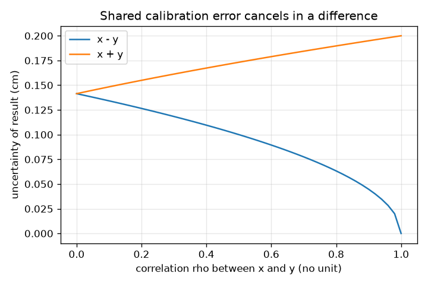
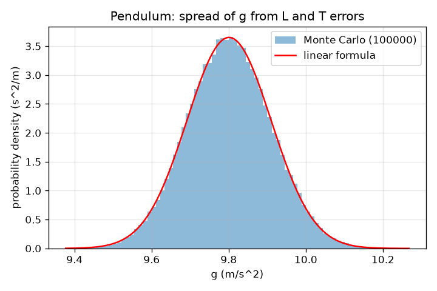

# Session 2: The propagation formula and the error budget

*Level 2 (mathematical engineering model) · about 75 minutes · openuncertainty*

> This is a simplified educational model. It is not a validated design tool and must not be used for real structures, electrical installations, vehicles, industrial processes or medical decisions.

**Prerequisites**

- Session 1: value +- error and relative error.
- A derivative as a slope (Section B explains the ones used).

**Learning objectives.** After this session you can:

- Use the standard deviation and the standard error of the mean s / sqrt(n) of repeated readings.
- Propagate uncertainty through f(x, y) with the first-order formula and check it by Monte Carlo.
- Apply the special cases for sums, products and powers, and the reporting rule of one significant figure.
- Build an error budget (variance shares) and use it to decide which measurement to improve.
- Explain how a shared calibration error (correlation) changes the answer.

## A. Real-world problem
A pendulum of length L and period T gives the acceleration of gravity g = 4 pi^2 L / T^2. You measure L = 1.000 m with a ruler good to 5 mm and T = 2.007 s with a stopwatch good to 10 ms. What is g, and how uncertain is it? You can improve only one instrument first: the ruler or the stopwatch. Which one, and by how much does the final uncertainty fall?

## B. Concept and theory
Repeated readings scatter around the true value. Their standard deviation s is the standard uncertainty of one reading. The mean of n readings has the smaller standard uncertainty s / sqrt(n), the standard error of the mean. For a result q = f(x, y) with small independent errors, expand f to first order (a straight line near the measured values): the variance of q is the sum of (slope times uncertainty) squared over the inputs. If the inputs are correlated, add twice the covariance times the product of the slopes. Special cases: for a sum or difference add the absolute uncertainties in quadrature; for a product or quotient add the relative uncertainties in quadrature; for a power x^n the relative uncertainty is n times that of x. The variance share of input i, (slope_i * u_i)^2 divided by the total variance, tells which input dominates (the error budget). Report the uncertainty with one significant figure and round the value to the same decimal place. A shared calibration error makes two readings move together (correlation rho close to 1), which cancels in a difference and doubles up in a sum.

| Symbol | Meaning | Unit |
|---|---|---|
| s | standard deviation of repeated readings | same as the reading |
| n | number of repeated readings | no unit |
| u_x, u_y | standard uncertainties of the inputs | same as the input |
| df/dx | sensitivity: slope of f with respect to x | unit of f per unit of x |
| rho | correlation between two inputs, from -1 to 1 | no unit |
| g | acceleration of gravity | m/s^2 |
| L, T | pendulum length and period | m, s |

**Assumptions**

- The errors are small, so f is close to a straight line over the error range.
- Errors are random and independent unless a correlation is stated.
- The pendulum is a point mass with small swings; real pendulums add systematic errors (amplitude, string mass) that this model leaves out.
- Uncertainties are standard uncertainties (one standard deviation), not worst cases.

$$ u_{\bar x}=\frac{s}{\sqrt n} $$

$$ u_q^2=\left(\frac{\partial f}{\partial x}\right)^2u_x^2+\left(\frac{\partial f}{\partial y}\right)^2u_y^2+2\,\frac{\partial f}{\partial x}\frac{\partial f}{\partial y}\,\rho\,u_xu_y $$

$$ g=\frac{4\pi^2L}{T^2},\qquad \frac{u_g}{g}=\sqrt{\left(\frac{u_L}{L}\right)^2+\left(2\frac{u_T}{T}\right)^2} $$

$$ \text{share}_i=\frac{(\partial f/\partial x_i)^2u_i^2}{u_q^2} $$

## C. Visual explanation
The first figure shows 100000 simulated values of g (histogram) with the Gaussian curve predicted by the linear formula on top: they overlap. The second figure shows the uncertainty of x - y and x + y as the correlation between x and y grows from 0 to 1: the difference shrinks to zero while the sum grows to twice the single uncertainty.

*A shared error (correlation) shrinks the uncertainty of a difference and grows that of a sum.*

*Spread of g from errors in L and T: Monte Carlo histogram and the linear-formula Gaussian agree.*

## D. Interactive simulation
Run the lesson (`python start.py 2`), then open the live app: [Session 2: error budget of a pendulum](https://krunalpanchal1995.github.io/openuncertainty/session-02/) (or `app.html` in this folder). Move the two sliders for the length and period uncertainty and watch which bar (length or period) dominates the relative uncertainty of g.

**Challenge.** Bring the relative uncertainty of g down to 0.6 percent or less.

## E. Worked example and experiment
**Problem.** For L = 1.000 +- 0.005 m and T = 2.007 +- 0.010 s, find g, its uncertainty, the variance shares of L and T, and the reported value.

1. g = 4 pi^2 * 1.000 / 2.007^2 = 9.801 m/s^2.
2. Relative uncertainty of L: 0.005 / 1.000 = 0.50 percent. Of T: 0.010 / 2.007 = 0.50 percent, but T is squared, so it counts 2 * 0.50 = 1.00 percent.
3. Combine in quadrature: sqrt(0.50^2 + 0.995^2) = 1.115 percent, so u_g = 0.01115 * 9.801 = 0.109 m/s^2.
4. Variance shares: L gives 0.25 / 1.24 = 20 percent and T gives 80 percent.
5. One significant figure of uncertainty: 0.109 rounds to 0.1, so the value is written 9.8 +- 0.1 m/s^2. Monte Carlo agrees: its spread is 0.109 m/s^2 within 1 percent.

**Answer.** g = 9.8 +- 0.1 m/s^2 (u_g = 0.109, 1.1 percent); the period supplies 80 percent of the variance.

**Experiment.** Hang a weight on a 1 m string, time 10 swings with a phone stopwatch, and divide by 10 to get T. Compute g with the formula and compare with 9.8 m/s^2. Expect a few percent difference. Reasons: the string and bob are not a point mass, the swing amplitude matters, your reaction time (about 0.1 s) is a systematic delay at start and stop, and the ruler is read at one end. The model includes only the random reading errors.

## F. Assessment and design challenge
**Question type A: Conceptual.** Why do we add uncertainties in quadrature (square, add, square root) instead of adding them directly? When would adding them directly be right?

Hint

Two independent errors sometimes push the same way and sometimes opposite ways. Compare 0.141 and 0.2 for two errors of 0.1.

Step-by-step solution

Independent errors partly cancel on average, so the combined spread is smaller than the plain sum: for two errors of 0.1 added in quadrature the result is 0.141, not 0.2. Direct addition is right only when the errors are fully correlated and act in the same direction (correlation rho = 1): then a sum has uncertainty 0.2 exactly. A difference of fully correlated errors cancels to 0.

**Question type B: Numerical.** A pendulum has L = 0.500 +- 0.002 m and T = 1.419 +- 0.005 s. Find g and its uncertainty, and say which input dominates.

Hint

Relative errors: u_L / L and 2 u_T / T, then combine in quadrature.

Step-by-step solution

g = 4 pi^2 * 0.500 / 1.419^2 = 9.803 m/s^2. Relative errors: 0.40 percent for L and 2 * 0.352 = 0.70 percent for T. Total sqrt(0.40^2 + 0.70^2) = 0.81 percent, so u_g = 0.079 m/s^2 and g = 9.80 +- 0.08 m/s^2 (one significant figure of uncertainty, value rounded to the same place). The period dominates (shares 24 and 76 percent). Sanity check: g is close to 9.8.

**Question type C: Graph and simulation interpretation.** In the correlation figure, read the uncertainty of x - y and of x + y at rho = 0.9 for two inputs with u = 0.1 cm. What does a shared calibration error do?

Hint

The two curves start together at rho = 0 (0.141) and separate.

Step-by-step solution

At rho = 0.9 the difference has u = 0.045 cm and the sum has u = 0.195 cm. A shared calibration error (both readings too high by the same amount) cancels in a difference and adds up in a sum. At rho = 1 the difference has no uncertainty from that source and the sum has 0.2 cm.

**Question type D: Design and optimisation challenge.** Design: the target is a relative uncertainty of g of 0.6 percent or less. The stopwatch error for one swing is 0.1 s, so timing n swings and dividing gives u_T = 0.1 / n s. Choose n and the ruler error to meet the target. Is improving only the ruler enough?

Hint

Compute the total for (u_L, n) = (5 mm, 10), (2.5 mm, 10), (5 mm, 20) and (2.5 mm, 20).

Step-by-step solution

With 5 mm and 10 swings (u_T = 0.010 s): 1.115 percent, fails. A better ruler alone (2.5 mm): 1.03 percent, fails; even a perfect ruler leaves 1.00 percent because T dominates. Twenty swings alone (u_T = 0.005 s): 0.71 percent, still fails. Both together (2.5 mm and 20 swings): 0.56 percent, meets the target. Trade-off: more swings costs only patience (and amplitude decay at some point), while a better ruler costs money; start with the stopwatch.

Score yourself with [RUBRIC.md](../../RUBRIC.md). Print the [activity sheet](activity_sheet.md) to work on paper.

## Common misconceptions
| Common misconception | What is actually true |
|---|---|
| The uncertainty of g is the sum of the uncertainties of L and T. | Independent uncertainties combine in quadrature, after multiplying each by its sensitivity. |
| Every input counts equally. | Inputs enter with their own slope: a power of 2 doubles the relative error, so T counts twice as much as L. |
| More readings reduce the standard deviation s of one reading. | More readings do not change s; they reduce the standard error of the mean s / sqrt(n). |
| Correlation always makes the answer worse. | A shared error cancels in a difference and doubles in a sum; the sign of the slopes decides. |
| Quote as many digits as the calculator gives. | One significant figure for the uncertainty, and the value rounded to the same decimal place. |

## Glossary
- **standard uncertainty**: the uncertainty of a value expressed as one standard deviation
- **standard error of the mean**: s / sqrt(n): the uncertainty of the average of n readings
- **sensitivity**: the slope of the formula with respect to one input
- **variance share**: the fraction of the output variance caused by one input
- **correlation**: how strongly two errors move together, from -1 to 1
- **quadrature**: combining by squaring, adding and taking the square root

## Finish
1. Do the three coding tasks in [exercises.md](exercises.md).
2. Run `python start.py 2` again after your changes. It ends with the checkpoint; when it prints `PASS`, you are done. (Checkpoint only: `python start.py check 2`.)

Next: [Session 3](../session-03/README.md)
