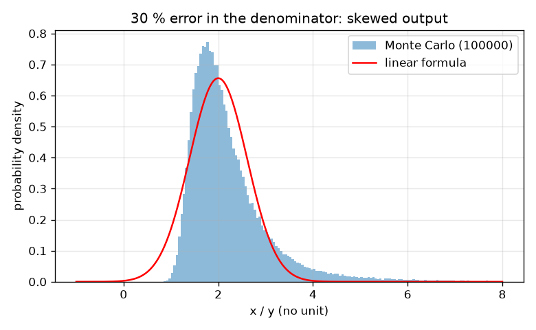
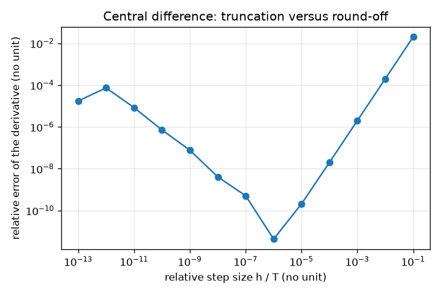

# Session 3: Monte Carlo propagation and where linear fails

*Level 3 (simulation and validation) · about 90 minutes · openuncertainty*

> This is a simplified educational model. It is not a validated design tool and must not be used for real structures, electrical installations, vehicles, industrial processes or medical decisions.

**Prerequisites**

- Session 2: the propagation formula and the error budget.
- Random numbers: a generator with a seed gives the same list each time.

**Learning objectives.** After this session you can:

- Propagate uncertainty by Monte Carlo (seeded, N = 100000) and read a 95 percent interval from percentiles.
- Compute a derivative by central differences and choose the step size.
- Combine uncertainties the GUM way, including a uniform resolution term LSB / sqrt(12), and report with k = 2.
- Show that the linear formula fails for a ratio with a large denominator error and at a maximum, and explain why.
- Build and report an error budget for a measured density.

## A. Real-world problem
A lab reports a ratio x / y where the denominator y is measured with a 30 percent error. The linear formula gives a symmetric interval. But a denominator that might be small makes the ratio huge, so the true interval cannot be symmetric. Another case: a quantity measured at the top of a curve, where the slope is zero, would get zero uncertainty from the linear formula, yet the true value still scatters. How do we find honest intervals, and how do we know when the shortcut is safe?

## B. Concept and theory
Monte Carlo propagation draws each input at random from its distribution, pushes every draw through the formula and studies the list of outputs: the spread is the standard uncertainty and the 2.5th and 97.5th percentiles give a 95 percent interval that need not be symmetric. It agrees with the linear formula when the errors are small enough for f to look like a straight line. A derivative for the linear formula can be found numerically by central differences, (f(x+h) - f(x-h)) / (2h); a step h that is too large blurs the curve and one that is too small loses digits to round-off, so a relative step of about 1e-6 is a good start. A digital instrument shows a value rounded to a step LSB; the true value is anywhere in a band of width LSB, a uniform distribution with standard deviation LSB / sqrt(12). The GUM combines standard uncertainties in quadrature into the combined uncertainty u_c, and reports an expanded uncertainty U = k u_c with coverage factor k = 2 (about 95 percent for a normal distribution). Where the slope is zero, the first-order variance is zero; the next term of the expansion gives a spread of |f''| u^2 / sqrt(2) for a normal input of spread u.

| Symbol | Meaning | Unit |
|---|---|---|
| N | number of Monte Carlo draws (100000) | no unit |
| h | step of a central difference | unit of x |
| LSB | step of a digital reading | unit of the reading |
| u_c | combined standard uncertainty | unit of the result |
| k | coverage factor (2) | no unit |
| U | expanded uncertainty k u_c | unit of the result |
| f'' | second derivative (curvature) | unit of f per unit of x squared |

**Assumptions**

- Inputs are independent; normal unless stated (uniform for resolution).
- The random generator is seeded, so results repeat; a different seed changes the last digits.
- Only random (type A) and resolution or certificate (type B) terms are modelled; unknown systematic errors are not.
- This is a teaching model of the GUM idea, not a certified calibration procedure.

$$ f'(x)\approx\frac{f(x+h)-f(x-h)}{2h} $$

$$ u_{\text{uniform}}=\frac{\mathrm{LSB}}{\sqrt{12}} $$

$$ u_c=\sqrt{\sum_i\left(\frac{\partial f}{\partial x_i}u_i\right)^2},\qquad U=k\,u_c,\; k=2 $$

$$ f(x)\approx f(x_0)+\tfrac12 f''(x_0)(x-x_0)^2\;\Rightarrow\;\sigma_f=\frac{|f''|\,u^2}{\sqrt2}\quad(f'(x_0)=0) $$

## C. Visual explanation
The first figure shows the histogram of x / y for a 30 percent denominator error with the linear Gaussian on top: the histogram leans to the right and has a long tail, and the Gaussian is too narrow at the top end. The second figure plots the error of the central-difference derivative against the step size on logarithmic axes: the error falls with the step like h squared, reaches a minimum near a relative step of 1e-6 and then rises again because of round-off.

*A 30 percent denominator error: the Monte Carlo histogram is skewed and the linear Gaussian misses its upper tail.*

*Central-difference error against the relative step size: truncation error on the right, round-off on the left.*

## D. Interactive simulation
Run the lesson (`python start.py 3`), then open the live app: [Session 3: a ratio with an uncertain denominator](https://krunalpanchal1995.github.io/openuncertainty/session-03/) (or `app.html` in this folder). Raise the relative error of the denominator in the app and watch the exact interval become lopsided while the linear interval stays symmetric.

**Challenge.** Find the largest whole-percent denominator error for which the upper end of the linear interval is within 5 percent of the exact one.

## E. Worked example and experiment
**Problem.** x = 10.0 +- 0.5 and y = 5.0 +- 1.5 (a 30 percent error). Find x / y with the linear formula and with Monte Carlo, and say whether the linear 95 percent interval is trustworthy.

1. x / y = 10.0 / 5.0 = 2.0. Relative errors: 0.5 / 10 = 5 percent and 1.5 / 5 = 30 percent.
2. Linear: u = 2.0 * sqrt(0.05^2 + 0.30^2) = 2.0 * 0.304 = 0.61. The 95 percent interval is 2.0 +- 1.96 * 0.61 = 0.81 to 3.19.
3. Monte Carlo: draw 100000 pairs, divide, take the 2.5th and 97.5th percentiles: 1.24 to 4.85.
4. The Monte Carlo interval is lopsided: 0.76 below 2.0 but 2.85 above. Small y values give big ratios.
5. The linear interval holds only about 89 percent of the outcomes instead of 95 percent. For a 1 percent denominator error both methods give 1.80 to 2.20.

**Answer.** Linear 0.81 to 3.19 (symmetric), Monte Carlo 1.24 to 4.85 (asymmetric). With a 30 percent denominator error the linear formula is not trustworthy.

**Experiment.** Measure the resistance R = V / I with a cheap multimeter at a very small current, where the current reading has a large relative error; repeat the experiment many times and plot R. You will see the right-leaning histogram of the model. Differences come from meter offsets and noise that is not normal: the model assumes normal errors and a correct formula.

## Real-world application and mini-project: Error budget for the density of a metal cylinder
A cylinder is measured with digital calipers (step 0.01 mm) and a scale (step 0.01 g, calibration uncertainty 0.01 g). Five readings of the diameter in mm: 12.71, 12.69, 12.70, 12.72, 12.68. Five readings of the height in mm: 50.02, 49.98, 50.01, 50.03, 49.96. One mass reading: 17.10 g. For each input, combine the standard error of the mean (where you have repeated readings) with the resolution term LSB / sqrt(12) in quadrature; for the mass combine the resolution term with the 0.01 g calibration term. Then propagate to the density rho = m / (pi (d/2)^2 h), with diameter and height in cm.

**Deliverable:** A script that prints the three standard uncertainties, the density, the combined and expanded (k = 2) uncertainty, the variance share of each input, a Monte Carlo check (N = 100000, seeded) and the final report line, and saves a bar chart of the shares.

**Success looks like:** The report reads 2.700 +- 0.007 g/cm^3 (k = 2), the diameter is named as the dominant contributor (77 percent of the variance), and the Monte Carlo spread agrees with the linear one within 2 percent.

## F. Assessment and design challenge
**Question type A: Conceptual.** Why does the linear formula fail for a ratio when the denominator has a large relative error, and why is the true interval skewed to the right?

Hint

Picture the curve 1 / y and a band of y values around 5.

Step-by-step solution

The linear formula replaces the curve 1 / y by its tangent line at the measured y. For a wide band of y the curve bends away from the tangent: values of y below the mean give a bigger change in x / y than values above. The result is a long tail to the right (small y give large ratios) and a compressed side to the left, so the true interval is lopsided and the symmetric linear one misses the upper end.

**Question type B: Numerical.** A digital caliper shows steps of 0.1 mm. Find the standard uncertainty from the resolution and the expanded uncertainty with k = 2.

Hint

Use LSB / sqrt(12), then multiply by k.

Step-by-step solution

u = 0.1 / sqrt(12) = 0.0289 mm. U = 2 * 0.0289 = 0.0577 mm, about +- 0.06 mm. Sanity check: the reading could be off by at most half a step, 0.05 mm, and a uniform band has a standard deviation well below that, so 0.029 mm is plausible; k = 2 gives a slightly wider interval than the half step.

**Question type C: Graph and simulation interpretation.** In the first figure, estimate by eye where the upper 95 percent end is for the histogram and for the Gaussian. What does the difference mean for a lab report?

Hint

The worked example lists both intervals.

Step-by-step solution

The Monte Carlo interval ends at 4.85 and the linear one at 3.19. A report using the linear interval would claim the ratio cannot exceed about 3.2, but 2.5 percent of outcomes go above 4.85 and roughly a tenth of all outcomes fall outside the linear interval. The honest report gives the asymmetric Monte Carlo interval 1.2 to 4.9.

**Question type D: Design and optimisation challenge.** Design: for the ratio x / y with a 5 percent error in x, at which relative errors of y is the linear upper end within 5 percent of the Monte Carlo upper end? Test 10 percent and 30 percent.

Hint

Compute both intervals for each case with the lesson functions.

Step-by-step solution

At a 10 percent error of y: linear 1.56 to 2.44, Monte Carlo 1.62 to 2.53; the upper ends differ by 3.6 percent, so linear is acceptable. At 30 percent the upper ends are 3.19 and 4.85, a difference of 34 percent, so the linear formula fails. Rule of thumb: keep the relative error of a denominator at or below about 10 percent, or use Monte Carlo. Trade-off: Monte Carlo costs 100000 evaluations, which is cheap here and costly for a slow simulation.

Score yourself with [RUBRIC.md](../../RUBRIC.md). Print the [activity sheet](activity_sheet.md) to work on paper.

## Common misconceptions
| Common misconception | What is actually true |
|---|---|
| Monte Carlo is exact. | It has its own sampling noise (shrinks like 1 / sqrt(N)); the result changes a little with the seed. |
| The linear formula is always a good approximation. | It needs small errors and a smooth, not too curved function; a ratio with a large denominator error and a maximum both break it. |
| Zero slope means zero uncertainty. | At a maximum the first-order uncertainty is zero but the output still scatters, because of the curvature. |
| A smaller step h always gives a better derivative. | Below a point, round-off makes it worse (error grows from 4e-12 at 1e-6 to 2e-5 at 1e-13). |
| A digital reading of 12.70 mm has no uncertainty. | The last digit is rounded; the uniform band of width LSB gives LSB / sqrt(12). |

## Glossary
- **Monte Carlo**: estimating a result by many random trials
- **seed**: a number that makes a random generator repeat its list
- **percentile interval**: the range between two percentiles of the outcomes, such as 2.5 and 97.5
- **central difference**: slope estimated from points on both sides
- **LSB**: the step of a digital reading
- **coverage factor k**: the multiplier that turns a standard uncertainty into an expanded one
- **expanded uncertainty**: k times the combined standard uncertainty

## Finish
1. Do the three coding tasks in [exercises.md](exercises.md).
2. Run `python start.py 3` again after your changes. It ends with the checkpoint; when it prints `PASS`, you are done. (Checkpoint only: `python start.py check 3`.)

Next: the [roadmap](../../promo/roadmap.md). Session 4 is yours to build.
